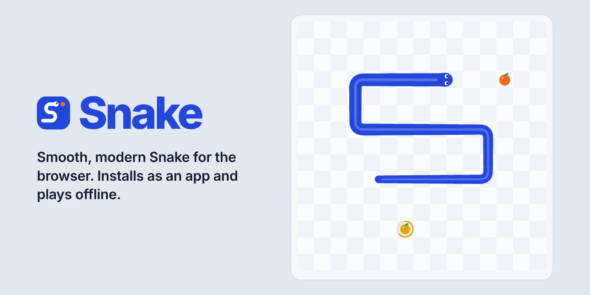

<p align="center">
  
</p>

<p align="center">
  <a href="https://github.com/chourouk5885/snake-game/actions/workflows/deploy.yml"></a>
  <a href="LICENSE"></a>
</p>

<p align="center"><strong><a href="https://chourouk5885.github.io/snake-game/">Play the live demo →</a></strong></p>

A complete, polished Snake game written in plain TypeScript with a `<canvas>` board — no UI framework. It installs as a desktop or phone app, opens in its own window, and works offline.

## Features

- **Tight controls.** Turns are queued (up to two per tick), so a quick "up, then left" never loses a key press. Arrow keys, WASD, swipes and an optional on-screen D-pad.
- **Smooth motion.** A fixed-timestep game loop with interpolation: the snake glides between cells at any refresh rate instead of jumping.
- **A snake that looks like one.** One continuous, tapering body with rounded corners and eyes that face where it's going.
- **Classic and Wrap modes**, three board sizes (15×15, 20×20, 25×25), speed that ramps up every 5 fruit, and golden fruit worth 5× for a few seconds.
- **Feedback** — particle bursts, a head squash, a floating "+points" label, level-up banners, a screen shake and grey fade on game over, optional Web Audio sound effects and phone vibration.
- **Light and dark themes** that follow your system, or a fixed choice that's remembered.
- **Accessible** — labelled buttons, visible focus, native `<dialog>`s, an `aria-live` region for score, level and game over, and full respect for `prefers-reduced-motion`.
- **Remembers you** — settings, best score per mode and size, and lifetime stats saved in `localStorage` (and the game still works if storage is blocked).
- **Installable PWA** with a hand-written service worker and window-controls-overlay support on Chrome and Edge.

## Controls

| Action | Keyboard | Touch |
| --- | --- | --- |
| Steer | <kbd>↑</kbd> <kbd>↓</kbd> <kbd>←</kbd> <kbd>→</kbd> or <kbd>W</kbd> <kbd>A</kbd> <kbd>S</kbd> <kbd>D</kbd> | Swipe on the board, or use the D-pad |
| Start | Any direction key, or <kbd>Enter</kbd> | Swipe |
| Pause / resume | <kbd>Space</kbd> or <kbd>P</kbd> | Pause button; tap the board to resume |
| Play again | <kbd>Enter</kbd> | Play again button |
| Settings | <kbd>Esc</kbd> | Settings button |

The game pauses by itself when the window loses focus or the tab is hidden.

## Rules

- The board is 20×20 by default. The snake starts 3 cells long in the middle, facing right, and waits for your first key.
- Each fruit grows the snake by one and scores **10 × level**. A golden fruit scores **5 ×** that and disappears after about 6 seconds — the ring around it shows the time left.
- Every 5 fruit is a new level: the snake speeds up from 7 moves per second, one step per level, up to 16.
- Running into yourself ends the game. Moving into the cell your tail is leaving that same tick is fine.
- **Classic:** walls end the game. **Wrap:** you come out on the other side.
- Fill the whole board to win.

## How it works

### Fixed-timestep loop

`src/engine/loop.ts` separates *when the rules run* from *when the screen is drawn*. Each animation frame adds the real elapsed time to an accumulator; while the accumulator holds at least one step (1000 ms ÷ current speed), the game advances one tick. The rules therefore run at exactly the game speed whether your display is 60 Hz or 144 Hz. Frame gaps are clamped to 250 ms, so returning to a background tab never makes the snake jump ahead.

### Interpolation

After running the ticks, the leftover time divided by the step length gives `alpha` (0–1): how far we are towards the next tick. The snake remembers its body from before the last move, and the renderer draws the head part-way from its old cell to its new one, the tail part-way out of the cell it is leaving, and every segment in between on its cell centre. Corners stay exactly where the turns happened, and the body is drawn as one tapering, rounded line. In Wrap mode the line is "unwrapped" across the edge and drawn again one board-width over, so the snake slides out of one side and into the other.

### Input buffer

`src/game/input-buffer.ts` holds up to two turns. Each key press is checked against the *last queued* turn (or the current direction): repeats and reversals are dropped, and a third press is ignored. One turn is taken per tick. Press "up, left" faster than one tick and you get up on this tick and left on the next — which is what makes tight corners and quick U-turns reliable.

### Project layout

```
src/
  game/      Pure rules, no DOM: snake.ts, rules.ts, input-buffer.ts, types.ts
  engine/    loop.ts — fixed-timestep loop
  ui/        renderer.ts, effects.ts, input.ts, sound.ts, theme.ts, hud.ts, dialogs.ts
  state/     store.ts — settings, best scores and stats in localStorage
  pwa.ts     service worker registration and Install button
  main.ts    wires everything together
  styles.css every colour as a CSS custom property, shared with the canvas
public/      manifest, service worker, icons
tests/       Vitest unit tests
```

Randomness is injected (`random: () => number`), so the rules are fully deterministic under test.

## Run it locally

You need Node.js 20.19 or newer.

```bash
npm install
npm run dev      # start the dev server at http://localhost:5173/snake-game/
npm test         # run the unit tests once
npm run build    # type-check and build to dist/
npm run preview  # serve the production build (service worker included)
```

The service worker only registers in production builds, so use `npm run preview` to try offline mode and installation.

## Deploy to GitHub Pages

1. Push this project to a GitHub repository named `snake-game`.
2. In the repository, open **Settings → Pages** and set **Source** to **GitHub Actions**.
3. Push to `main`. The workflow in `.github/workflows/deploy.yml` installs dependencies, runs the tests, builds, and deploys `dist/`. If any test fails, nothing is deployed.

The site is served from `/snake-game/`. For a different repository name, a user site, or a custom domain, set the `BASE_PATH` environment variable for the build (for example `BASE_PATH=/` ) or change `base` in `vite.config.ts`.

## Install it as an app

- **Chrome or Edge:** click **Install** in the game's toolbar, or the install icon in the address bar. The toolbar then sits in the window's title bar.
- **Safari on Mac:** File → Add to Dock.
- **iPhone and iPad:** Share → Add to Home Screen.

## License

[MIT](LICENSE)
